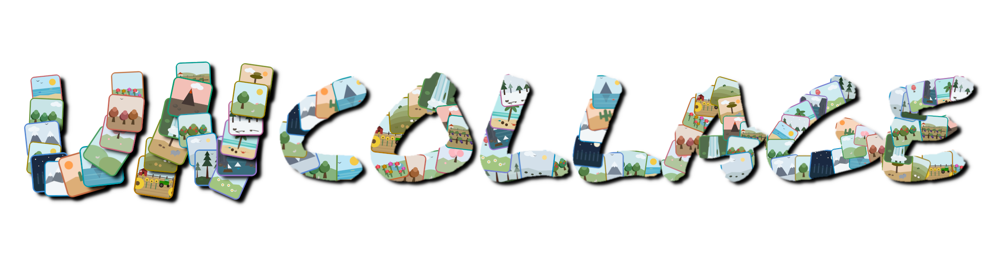

<p align="center">

</p>

# Uncollage

Splits scanned pages and collages into their individual photos. Detection uses
the paper around the photos (any colour, uneven lighting is fine), so photos may
touch each other or the page edge and may be tilted or oddly shaped. Each photo
is cropped as an upright rectangle with a small margin, so nothing is cut off
(neighbouring crops may overlap). Crops are **pixel-identical** to the source.

| Program | What it does |
|---|---|
| `uncollage.py` | Automatic splitting, with a box editor for pages it can't split. |
| `draw_boxes.py` | Box editor; also usable on its own. |

**Requirements:** `pip install -r requirements.txt` (`opencv-python`, `numpy`;
`Pillow` is optional and makes the editor faster), plus `tkinter` for the
editor (`sudo apt install python3-tk` if missing).

---

## uncollage.py

```
python uncollage.py INPUT [OUTPUT]
```

- `INPUT`: an image, a folder (non-recursive; crops it wrote earlier are
  skipped) or a text file with one image path per line.
- `OUTPUT`: folder for the crops; default is next to each source.

Crops are named `<image>_1`, `<image>_2`, … row by row, left to right. Pages
that already have crops in the output folder are skipped, so a re-run never
overwrites anything and simply resumes an interrupted batch. A
lossless source keeps its format; JPEG/WebP crops are saved as PNG, since
re-encoding would change pixels. Crops whose colour channels are identical are
saved as one-channel grey (same values, a third of the size). EXIF orientation
is not applied.

| Option | Meaning |
|---|---|
| `-t`, `--touching` | Also cut photos butted together with **no** gap (straight shadow seams and print edges). Off by default: it can cut a photo along its own straight horizon. |
| `-d`, `--debug` | Write contact sheets into `uncollage_debug/` in the output folder: every page with its numbered boxes, 12 per sheet. Red = cropped, magenta = queued, green = from the manual file, blue = drawn this run. |
| `--overwrite` | Re-crop pages that already have crops, replacing them. |
| `-j N`, `--cores N` | CPU cores to use; `1` = one page at a time. Default: all cores (~3.5x faster on 6), fewer only if free memory is short. |
| `--no-draw` | Don't open the editor; just list failed pages in the manual file. |
| `--manual FILE` | Manual-boxes file (default `manual_boxes.txt`). |

```
python uncollage.py scans/ crops/         # whole folder -> crops/
python uncollage.py scans/ crops/ -d      # + contact sheets
python uncollage.py montages/ crops/ -t   # butted composites
```

### Pages it can't split

A page whose result looks merged or empty is queued instead of cropped. After
the batch the editor opens for each queued page, showing the boxes detection
found so you can just adjust them; they are cropped right away and cached in
the manual-boxes file, so later runs reuse them.
Without a display (or with `--no-draw`), draw them later:

```
python draw_boxes.py manual_boxes.txt     # then re-run the uncollage command
```

### How it works

1. Detection runs on a copy scaled to at most 3000 px; boxes are mapped back
   to full resolution.
2. The background is a smooth surface fitted to the page's edge pixels, which
   handles any paper colour and lighting gradients. (A frameless montage uses
   its most frequent colour instead.)
3. Smooth pixels close to that surface and connected to the border are
   background; pale areas inside a photo stay part of it.
4. Each large blob is a photo. Photos touching at a corner or bridged by a
   shadow are split by eroding the blob into one core per photo; photos parted
   by a gap too thin for the mask are cut along that paper-coloured line.
   A split is kept only if every piece is clearly rectangular.

---

## draw_boxes.py

```
python draw_boxes.py IMG [OUTPUT]                 # adjust boxes on one image and crop it
python draw_boxes.py manual_boxes.txt [--redo]    # draw the pages uncollage.py queued
```

| Action | How |
|---|---|
| New box | drag (also inside another box, so boxes may overlap) |
| Resize / move | drag a corner / an edge |
| Zoom / pan | mouse wheel / right- or middle-drag |
| Buttons | **Undo · Clear · Save · Cancel** (hover for a tooltip) |
| Keys | `u` undo · `r` clear · `s`/`Enter` save · `q`/`Esc` cancel · `f` whole page · `w` fit width · `+`/`-` zoom |

The window opens centred, showing the whole page with a margin of background,
so a box around the whole page can start outside it. It starts with the boxes
automatic detection finds (one around the whole image if none). Every edit is
saved at once to `<boxes file>.draft`, so an interrupted session (Ctrl+C, closed
window) loses nothing and is offered again next time; Save or Cancel clears it.

---

## Limitations

- Photos that overlap, or touch along a whole edge with no gap or shadow, come
  out as one crop (try `--touching`).
- Faded, borderless photos and album pages whose sheet matches the photos are
  queued for manual boxes.
- A border exactly the paper's tone may be cropped off; the photo is kept.
- Tilted photos are not straightened, so their crops keep small paper corners.

Tests: see [tests/README.md](tests/README.md).
